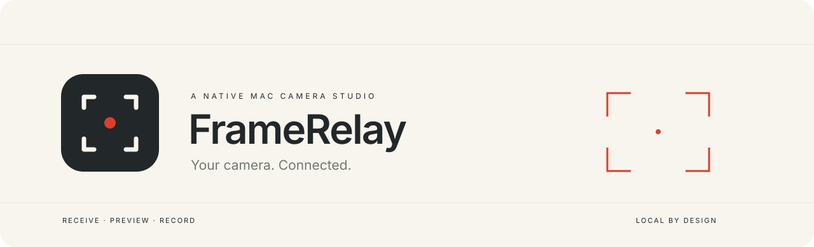
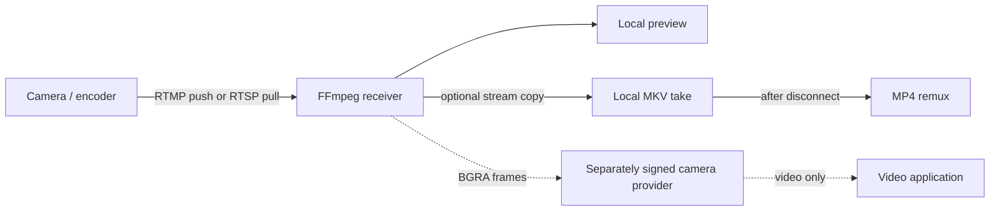

<div align="center">

# FrameRelay

**Your camera. Connected.**

A native Mac studio for receiving a network camera stream, previewing it and optionally saving each take locally.

[Getting started](#getting-started) · [Camera guide](docs/CAMERAS.md) · [Virtual camera](docs/VIRTUAL_CAMERA.md) · [Contributing](CONTRIBUTING.md)

**Early developer preview · macOS · SwiftUI · MIT**

</div>

---

FrameRelay started with a simple problem: a good mirrorless camera at a desk, an unreliable legacy webcam route, and a network stream that needed a reliable place to land. It keeps the receiver in the menu bar and gives connection, preview and recording controls a quiet, focused home.

## What works today

- Native studio window and menu-bar Start/Stop controls.
- Private-LAN RTMP receiving, with configurable interface, port and stream path.
- RTSP pull input for credential-free endpoints (implemented; camera runtime not yet verified).
- Live video preview; optional preview mirroring.
- Optional clip recording, with an independent camera-audio switch.
- Original-resolution/frame-rate stream-copy recording into MKV; MP4 remux after disconnect.
- Automatic re-arm between takes, disk reserve and graceful shutdown.
- Opt-in login startup and opt-in receiver auto-start.
- No account, telemetry or cloud uploads. Settings and clips remain local.

**Webcam output can use the separately signed [VirtualCamera4Mac](https://github.com/m96-chan/VirtualCamera4Mac) provider without your own Apple membership.** Install and approve its official release separately, then connect output in FrameRelay and select it in your video app. The native producer is implemented; activation and application tests are documented as they are completed. FrameRelay's own extension remains compile-only and needs developer signing. [Exact setup and test status](docs/VIRTUAL_CAMERA.md).

## Getting started

Requires macOS 14+, Apple Command Line Tools, and an installed FFmpeg/ffprobe. Apple Silicon has been exercised on macOS 27; older macOS versions and Intel are not runtime tested. Build on the Mac you intend to use.

```sh
# If you use Homebrew and do not already have FFmpeg:
brew install ffmpeg

bash scripts/build.sh
open build/FrameRelay.app
```

The build is locally ad-hoc signed, not a notarized public download. There is no prebuilt trusted release yet. Do not disable macOS security protections to run it.

1. In **Connection**, select the Mac's LAN interface and a path such as `live/camera`.
2. Set the displayed full destination on the camera. For separate fields, use the URL through `/live` as the server and `camera` as the key.
3. Choose whether to save clips under **Recordings**. Recording is off by default.
4. Start the receiver, then start the camera stream.
5. Stop streaming on the camera to finish the take. FrameRelay finalizes the clip and waits for the next connection.

Install the app in a stable Applications location before enabling login startup. A menu-bar Quit stays quit: the login agent does not continuously respawn the app. Closing the studio window keeps the menu bar running. Disable login startup in Settings before moving/removing the app.

**Keep the destination stable:** reserve the chosen interface's IP in your router's DHCP configuration. FrameRelay does not change router settings or silently switch addresses. No port forwarding is required. Use a trusted LAN: this RTMP listener is unencrypted and unauthenticated; the stream path is not a password. Only one producer is supported per receiver.

## Picture and sound

Recordings preserve the source codec, size and frame rate. The live preview and webcam bridge convert frames to 1920×1080 BGRA at 30 fps with letterboxing. Lower-resolution input is not magically native HD. The UI preview updates around 10 fps to reduce UI work; the bridge receives the decoded 30 fps frames.

Camera audio can be saved in clips. There is no live audio monitor or virtual microphone. Select a separate microphone in the video application. H.264/AAC is the recommended tested combination; unsupported MP4 codecs may keep an MKV instead. Network delay and lip sync require a real session check.

## Compatibility and limits

| Source | Evidence |
| --- | --- |
| Panasonic LUMIX S5IIX, firmware 2.2, RTMP-capable region | Real 1080p25 H.264/AAC transport captured in development; five short new-app takes decoded; long-session checks pending |
| Independent FFmpeg H.264/AAC publishers | ReceiverEngine preview, two-take reconnect and optional recording/audio tested |
| LUMIX GH5II / Canon EOS R5 Mark II | Vendor streaming documentation reviewed; not tested with FrameRelay |
| Credential-free RTSP cameras | Input path implemented; not hardware tested |

This is not an “all cameras / all software” compatibility promise. RTMPS listening, authenticated URLs, SRT, USB UVC input, HDMI ingest and virtual audio are not implemented. Some regional cameras require RTMPS and cannot connect directly. [Model and firmware details](docs/CAMERAS.md).

## Development

```sh
bash scripts/build.sh
bash scripts/check-extension.sh  # compile only; does not install a webcam
bash scripts/test.sh             # loopback integration tests; needs FFmpeg + ffprobe
```

Tests generate synthetic video only, under the system temporary directory. They exercise real FFmpeg processes, preview frame arrival, original-resolution recording, audio exclusion, preview without files, clean decode and reconnects. No real camera or signed extension is exercised by those tests.



See [architecture](docs/ARCHITECTURE.md), [verification](docs/VERIFICATION.md) and [security](SECURITY.md). Own code is MIT. FFmpeg is an external dependency with its own LGPL/GPL license determined by its build; it is not bundled or relicensed here.
